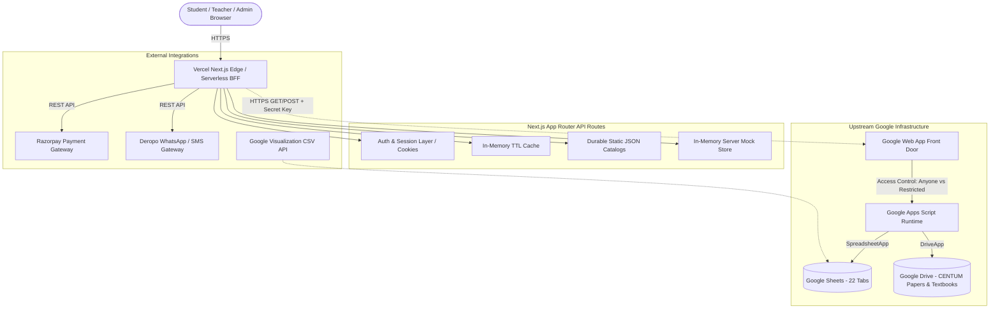
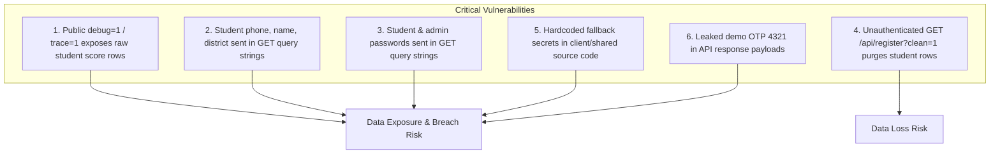
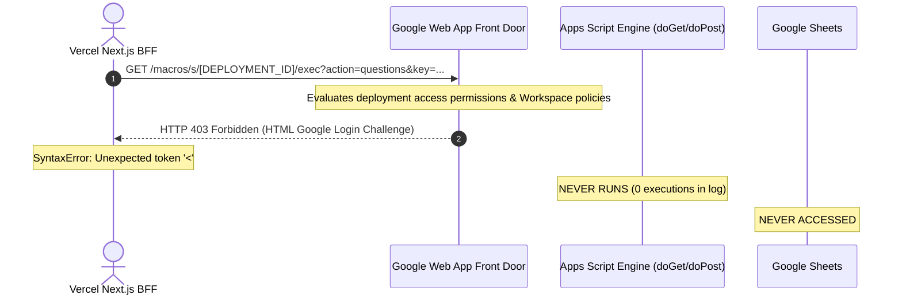

# CENTUM Backend Operating Map & Architecture Inventory
**Document Version:** 1.0.0 (Phase 1 Canonical Operating Map)  
**Status:** Read-Only Audit Complete — Awaiting Owner Approval  
**Audit Scope:** Full repository source code (`src/app/api/**`, `src/app/**`, `src/components/**`, root Apps Script modules, test pipelines) and production evidence.  
**Safety Classification:** Strictly Read-Only (Zero writes to Sheets/Drive, zero secrets/PII exposed, zero production deployments).

---

## 1. Executive Summary & Non-Negotiable Safety Rules

### 1.1 Mission Statement
Before proposing any architectural replacement or performing broad refactoring, this document establishes verifiable facts from the codebase and production telemetry. The goal is one clear backend map, one approved API/data contract, and a staged, test-driven remediation plan with safe rollbacks.

### 1.2 Non-Negotiable Safety Rules Compliance
1. **Read-Only Audit:** No code edits, deployments, reauthorizations, environment variable modifications, database provisions, or new Google Apps Script deployments were performed during this audit.
2. **Zero Sheet/Drive Mutations:** No production Google Sheet or Google Drive file was written to, renamed, moved, deleted, or had its permissions changed.
3. **Strict Credential & PII Privacy:** No secret keys (`APPS_SCRIPT_SECRET`), OTPs, student phone numbers, or raw student records are printed or requested in this document. Student identities are strictly excluded from URLs and logs.
4. **No Execution of Insecure Modes:** Public `debug=1` and `trace=1` modes in the leaderboard route were audited purely in source code without calling them or exposing student score rows.
5. **Zero Fabrication:** No questions, papers, news, textbook links, or student score entries have been invented.
6. **Fact Classification:** Every finding in this document is labeled as **`[VERIFIED]`**, **`[ASSUMPTION]`**, or **`[UNKNOWN]`**.

---

## 2. Evidence Baseline & Production Truth

The following baseline represents verified production evidence and must be preserved without reinterpretation:

| Metric / Finding | Production Evidence | Status | Technical Root Cause / Context |
| :--- | :--- | :--- | :--- |
| **Deployment ID Match** | The owner confirmed the Apps Script deployment ID called by Vercel matches the active Web App ID. | `[VERIFIED]` | Old-ID mismatch theory is ruled out. Redeploying blindly without access audit is prohibited. |
| **Production `/api/health`** | Returns HTTP 200, but reports `backend: "last-known-good"`, `upstreamGas.status: 403` with HTML content. | `[VERIFIED]` | Top-level `questionsReachable: true` and `papersReachable: true` reflect local committed JSON catalogs, **not** upstream GAS health. |
| **Production `/api/leaderboard`** | Returns HTTP 503 `backend-unreachable`. | `[VERIFIED]` | Upstream GAS 403 bubbles up as HTTP 503 when environment variables exist; does not fall back to mock data. |
| **Production `/api/news`** | Returns HTTP 503 `backend-unreachable`. | `[VERIFIED]` | Upstream GAS 403 bubbles up as HTTP 503; no static catalog fallback exists for news. |
| **Class 10 Concept Questions** | Fallback serves Chapters 1–3 for Maths and Science; Social Science has Chapter 1 only; English and Tamil have 0 questions. | `[VERIFIED]` | English and Tamil having 0 questions is **missing academic content** in the bank, not an API crash or paywall lock. |
| **Class 6 Social Target** | Target: `totalMatching = 532`, `lockedChapters.length = 31`. | `[VERIFIED]` | Target cannot be verified against raw Google Sheet while upstream returns 403. Current fallback data does not reflect this target. |
| **Textbooks Inventory** | Previously returned 158 Class 10 tracker entries. | `[VERIFIED]` | Verifies the Google Visualization CSV feed structure, but does not verify complete mobile UI playback. |
| **Time-driven GAS Executions** | Previous logs showed timed executions running in Apps Script. | `[VERIFIED]` | Timed triggers (`dailyQuizAuto_()`) execute on Google's clock; they are **not** evidence that Vercel's Web App requests ran. |

---

## 3. High-Level Architecture Overview

CENTUM operates as a hybrid architecture composed of a Next.js (App Router) frontend/BFF (Backend-for-Frontend) deployed on Vercel, paired with a Google Apps Script (GAS) Web App acting as a serverless database adapter over Google Sheets and Google Drive.



### Architectural Chokepoint: The Upstream Google Front Door
Every live read and write that traverses Next.js to Google Sheets passes through `APPS_SCRIPT_URL`. When Google's front door issues an HTTP 403 login challenge, Vercel cannot reach the script, causing:
1. Endpoints with committed catalogs (`/api/questions`, `/api/papers`) to drop into **catalog fallback mode**.
2. Endpoints requiring dynamic live data (`/api/leaderboard`, `/api/news`, `/api/dailyquiz`) to fail with **HTTP 503**.
3. Endpoints writing data (`/api/score`) to drop into **mock mode**, returning fake success while **silently dropping student scores**.

---

## 4. Feature Inventory (Verified from Code)

The codebase contains 16 verified functional domains across student, tuition teacher, and administrator interfaces:

```
+----------------------------------------------------------------------------------------------------+
|                                     CENTUM SYSTEM DOMAINS                                         |
+------------------------------------+-----------------------------------+---------------------------+
| 1. Student Practice & Quizzes      | 2. Academic Resources & Content   | 3. Commerce & Gamification|
|    - Chapter Concept Quizzes       |    - Question Papers & PDF Viewer |    - Razorpay Checkout    |
|    - One-Word MCQ Practice         |    - Textbooks & PDF Chunking     |    - Subscription Gating  |
|    - Daily Quiz & Today's Quiz     |    - Pro Materials & Video Shelf  |    - Centum Coins & Store |
|    - Score Submission & Streaks    |    - Educational News Feed        |    - Coupons & Referrals  |
+------------------------------------+-----------------------------------+---------------------------+
| 4. User Accounts & Identity        | 5. Tuition Centre Classrooms      | 6. Administration & Ops   |
|    - Cookie Sessions (HMAC-SHA256) |    - Student Tuition Dashboard    |    - Admin Dashboard      |
|    - Student Login & Set Password  |    - Daily Teacher Diary          |    - Founder Telemetry    |
|    - SMS OTP Verification          |    - Attendance Roster            |    - Content Management   |
|    - WhatsApp OTP Verification     |    - Sponsored Seat Redemption    |    - WhatsApp Webhooks    |
+------------------------------------+-----------------------------------+---------------------------+
```

### Domain 1: Student Practice & Quizzes
- **Concept Quizzes (`/class/[classLevel]/[subject]`):** Chapter-by-chapter concept MCQs. Controlled by `ConceptChaptersGrid.tsx` and `QuizRunner.tsx`. Free students access Chapters 1–3; Chapters 4+ show a paywall lock (`locked: true`).
- **One-Word MCQ Practice (`/class/[classLevel]/[subject]`):** Fast-paced objective question bank accessed via `/api/questions?type=oneword`.
- **Daily Quiz (`/daily`):** Single daily multi-subject quiz seeded every morning via `DailyQuizBanner.tsx` and `/api/dailyquiz`.
- **Today's Quiz (`/api/today-quiz`):** Dynamic scheduled quiz pulled from the `QuizSchedule` tab.
- **Score Submission (`/api/score`):** Submits student score, test duration, subject, and chapter to the `Scores` sheet.

### Domain 2: Academic Resources & Content
- **Question Papers (`/papers`, `/papers/[id]`):** Searchable archive of 990+ past annual and mid-term exam papers. Controlled by `PDFViewerModal.tsx` and `CleanPDFViewer.tsx`.
- **Drive Download Accelerator (`/api/drive/download`):** Resolves large-file confirmation tokens from Google Drive (>100MB) to bypass virus-scan interstitials.
- **Textbooks (`/textbooks`):** Full textbooks and unit-wise PDF chunks. Feed retrieved from Google Visualization CSV or static snapshot.
- **Pro Materials Shelf (`/pro-materials`):** Curated study guides, video lectures, and revision PDFs filtered by subject and class.
- **Pro Videos (`/api/pro-videos`):** Curated video tutorials embedded in lesson pages.
- **News Feed (`/news`, `/news/[id]`):** Official board exam notifications, timetables, and academic updates.

### Domain 3: Commerce & Gamification
- **Pricing & Checkout (`/pricing`):** Tier selection (`Free`, `Pro` at ₹499/yr, `Live Tuition` at ₹1999/yr). Order creation via `/api/order` (Razorpay) and HMAC signature verification via `/api/verify`.
- **Entitlement Gating (`/api/plan`):** Verifies if a user is `free` or `pro` by reading the `Subscriptions` sheet.
- **Coupons & Referrals (`/referrals`, `/api/coupon`):** Discount verification and automated generation of student referral share codes.
- **Centum Coins (`/coins`, `/api/coins`):** Virtual coin ledger rewarding daily logins, quiz completions, and referrals. Server-enforces earning caps and balance checks for avatar redemption.

### Domain 4: User Accounts & Identity
- **Student Authentication (`/login`, `/signup`):** Login via phone and password. Session issued via HTTP-only cookie `centum_session` signed with HMAC-SHA256.
- **Password Setup (`/api/login` POST):** Sets password for legacy pre-v4 accounts.
- **SMS OTP (`/api/auth/otp/send`, `/api/auth/otp/verify`):** Deropo SMS gateway with OTP hashes recorded in `OTPCodes` sheet.
- **WhatsApp OTP (`/api/send-otp`, `/api/verify-otp`):** Deropo WhatsApp messaging gateway with in-memory validation.

### Domain 5: Tuition Centre Classrooms
- **Tuition Hub (`/classroom`):** Dedicated portal for affiliated offline tuition centres.
- **Teacher Diary (`/api/owner-diary`):** Tuition teachers post homework, exam notices, and announcements.
- **Daily Attendance (`/api/owner-attendance`):** Roll-call tracking (`P`/`A`) recorded in `TuitionAttendance`.
- **Seat Claim (`/api/seat-claim`):** Bulk-purchased tuition centre seats redeemed by students.

### Domain 6: Administration & Operations
- **Admin Portal (`/admin`):** Dashboard displaying student registrations, revenue, and active subscriptions.
- **Founder Stats Telemetry (`/api/admin/founder-stats`):** Active user telemetry (24h/7d active students, registration pace, class distribution, top streaks).
- **Admin Content Upload (`/api/admin/material`):** Direct append to `Papers`, `News`, or `Questions` tabs.
- **WhatsApp Webhook (`/api/webhooks/deropo`):** Inbound WhatsApp webhook handling parent/student replies and opt-outs.

---

## 5. Complete Route & Data-Flow Table (All 49 Endpoints)

The following table comprehensively documents all 49 Next.js API routes in `src/app/api/**`:

| # | Route Path & Methods | Frontend Caller / Page | Params / Payload | GAS Action & Method | Sheet Tab / Drive | Read / Write | Auth Boundary | Current Source Tier | Failure Mode & User UX | Test Coverage | Status |
| :- | :--- | :--- | :--- | :--- | :--- | :--- | :--- | :--- | :--- | :--- | :--- |
| 1 | `GET /api/health` | Monitoring / Ops | None | `action=questions`, `action=papers` (GET) | `Questions`, `Papers` | Read | Public | Hybrid (`gas` or `last-known-good`) | Returns HTTP 200 with `backend: last-known-good` when GAS 403 | `verify-live-resources.mjs` | `[VERIFIED]` |
| 2 | `GET /api/questions` | Quiz runners, `/class/*` | `classLevel`, `subject`, `chapter`, `type`, `medium`, `plan` | `action=ops-rows&tab=Questions` or `action=questions` (GET) | `Questions` | Read | Session / Pro Header / Public | `last-known-good` (when GAS 403) | Serves 1810 LKG questions; Ch 1-3 free, Ch 4+ locked | `concept-gating.mjs` | `[VERIFIED]` |
| 3 | `POST /api/score` | `ScoreScreen.tsx` | `{phone, name, district, standard, subject, chapter, score, total, seconds}` | `type: "score"` (POST) | `Scores` | Write | Public / Client Body | Mock Fallback (when GAS 403) | Returns `{ok:true, recorded:true}` — **Silently drops score!** | `run-all-tests.mjs` | `[VERIFIED]` |
| 4 | `GET /api/leaderboard` | `LeaderboardBox.tsx`, `/leaderboard` | `standard`, `phone`, `name`, `district`, `debug`, `trace` | `action=leaderboard` (GET) | `Scores` | Read | Public (Exposes Debug/Trace!) | `live-failed` (503) | HTTP 503 `backend-unreachable`; UI shows error card | `api-truth-pipeline.mjs` | `[VERIFIED]` |
| 5 | `GET /api/papers` | `/papers`, `/papers/[id]` | `classLevel`, `subject`, `exam`, `medium`, `plan` | `action=papers` (GET) | `Papers`, Drive Folder | Read | Public | `catalog-fallback` | Falls back to `papers.json` (990 items) | `papers-medium-filter.mjs` | `[VERIFIED]` |
| 6 | `GET /api/drive/download` | `CleanPDFViewer.tsx` | `fileId` | None (Direct Drive Stream) | Google Drive File | Read | Public | Live Drive / Google Stream | Direct streaming pipe; returns 502 on stream error | `viewer-internal.mjs` | `[VERIFIED]` |
| 7 | `GET /api/textbooks` | `/textbooks` | `classLevel`, `subject`, `medium`, `format` | GViz CSV or `ops-rows&tab=Textbooks` | `Textbooks` (`1yt1z...`) | Read | Public | Live GViz CSV / `textbooks-snapshot.json` | Falls back to `textbooks-snapshot.json` (415 items) | `textbooks-section.mjs` | `[VERIFIED]` |
| 8 | `POST /api/textbooks` | Admin Textbooks Ops | `action: "purge-probes"`, `"drive-copy"` | `ops-textbooks-purge-probes` (POST) | `Textbooks`, Drive | Write | Secret Key Guarded | Live GAS / Mock Store | Updates drive file IDs or purges probes | `textbooks-live-ledger.mjs` | `[VERIFIED]` |
| 9 | `GET /api/dailyquiz` | `DailyQuizBanner.tsx`, `/daily` | `classLevel`, `stream`, `medium` | `action=dailyquiz` (GET) | `DailyQuiz` | Read | Public | `live-failed` (503) | HTTP 503 `backend-unreachable`; Banner hidden | `quiz-sets-pooled.mjs` | `[VERIFIED]` |
| 10 | `GET /api/today-quiz` | `/today` | `classLevel`, `medium`, `date` | `action=today-quiz` (GET) | `QuizSchedule` | Read | Public | `live-silent-hide` | Returns HTTP 200 `{quiz: null}`; Component hidden | `run-all-tests.mjs` | `[VERIFIED]` |
| 11 | `GET /api/news` | `/news`, `/news/[id]` | None | `action=news` (GET) | `News` | Read | Public | `live-failed` (503) | HTTP 503 `backend-unreachable`; News feed empty | `api-truth-pipeline.mjs` | `[VERIFIED]` |
| 12 | `GET /api/pro-materials` | `/pro-materials` | `classLevel`, `subject` | `action=proMaterials` (GET) | `ProMaterials` | Read | Public / Pro Filter | Mock Store Fallback | Serves in-memory mock materials | `pro-materials-pills.mjs` | `[VERIFIED]` |
| 13 | `GET /api/pro-videos` | Lesson Pages | `classLevel`, `subject`, `chapter` | `action=proVideos` (GET) | `ProMaterials` | Read | Public | Local Verified Fixtures | Serves curated YouTube lesson fixtures | `test-pro-videos-cleanup.mjs` | `[VERIFIED]` |
| 14 | `POST /api/order` | `PaywallSheet.tsx` | `{plan, phone, couponCode}` | None (Razorpay SDK) | `Coupons` (via GET) | Write | Client Session | Live Razorpay API | Generates Razorpay Order ID; fails if keys missing | `paywall-server-side.mjs` | `[VERIFIED]` |
| 15 | `POST /api/verify` | `PaywallSheet.tsx` | `{razorpay_order_id, razorpay_payment_id, razorpay_signature, phone, plan}` | `type: "payment"` (POST) | `Subscriptions`, `Students` | Write | Razorpay HMAC-SHA256 | Live GAS / Local Cookie | Appends subscription row; upgrades user cookie to Pro | `paywall-server-side.mjs` | `[VERIFIED]` |
| 16 | `GET /api/plan` | Nav, Entitlement checks | `phone` | `action=plan` (GET) | `Subscriptions` | Read | Session Cookie | Mock Store / Free Tier | Defaults user to `free` plan if upstream unreachable | `paywall-server-side.mjs` | `[VERIFIED]` |
| 17 | `GET /api/coupon` | `/pricing`, Checkout | `code` | `action=coupon` (GET) | `Coupons` | Read | Public | Live GAS / Mock Store | Returns `{valid: false}` when unreachable | `paywall-server-side.mjs` | `[VERIFIED]` |
| 18 | `GET /api/referrals` | `/referrals` | `phone` | `action=referrals` (GET) | `Referrals` | Read | Client Query (`phone`) | Live GAS / Mock Store | Returns empty referral stats | `run-all-tests.mjs` | `[VERIFIED]` |
| 19 | `POST /api/referrals/code` | `/referrals` | `{phone, name}` | `type: "referral-code"` (POST) | `Coupons` | Write | Client Body | Live GAS / Mock Store | Generates referral code; falls back to deterministic code | `run-all-tests.mjs` | `[VERIFIED]` |
| 20 | `GET /api/coins` | `/coins` | `phone` | `action=coins` (GET) | `CoinLedger` | Read | Client Query (`phone`) | Mock Store Fallback | Returns `{balance: 0, recent: []}` on failure | `run-all-tests.mjs` | `[VERIFIED]` |
| 21 | `POST /api/coins/earn` | Quiz Completion | `{phone, reason, ref, note}` | `type: "coin-earn"` (POST) | `CoinLedger` | Write | Client Body | Mock Store Fallback | Credits coins in server memory if GAS fails | `run-all-tests.mjs` | `[VERIFIED]` |
| 22 | `POST /api/coins/spend` | Avatar Store | `{phone, amount, reason, ref}` | `type: "coin-spend"` (POST) | `CoinLedger` | Write | Client Body | Mock Store Fallback | Debits coins in server memory if GAS fails | `run-all-tests.mjs` | `[VERIFIED]` |
| 23 | `GET /api/login` | `/login` | `phone`, `password` (in GET URL!) | `action=login` (GET) | `Students`, `Admins` | Read | Plaintext in Query URL! | Live GAS / Mock Store | Authenticates student, sets `centum_session` cookie | `demo-accounts.mjs` | `[VERIFIED]` |
| 24 | `POST /api/login` | First-time setup | `{phone, password}` | `type: "set-password"` (POST) | `Students` | Write | Client Body | Live GAS / Mock Store | Sets student password hash | `demo-accounts.mjs` | `[VERIFIED]` |
| 25 | `GET /api/auth/session` | Layout / Auth check | Cookie `centum_session` | None (Local Node.js) | None | Read | HMAC Cookie Signature | Local Cryptographic Verify | Decodes and verifies session cookie payload | `phone-normalizer.test.mjs` | `[VERIFIED]` |
| 26 | `POST /api/auth/logout` | User Profile / Nav | None | None (Local Node.js) | None | Write | Session Cookie | Local Cookie Clear | Sets expired cookies for `centum_session` and `centum_plan` | `run-all-tests.mjs` | `[VERIFIED]` |
| 27 | `POST /api/auth/otp/send` | SMS Auth Screen | `{phone}` | `action=ops-add&tab=OTPCodes` (GET) | `OTPCodes` | Write | Deropo SMS API | Deropo SMS API / Mock | Sends 4-digit SMS OTP, stores hash in sheet | `demo-accounts.mjs` | `[VERIFIED]` |
| 28 | `POST /api/auth/otp/verify` | SMS Auth Screen | `{phone, code}` | `action=ops-rows&tab=OTPCodes` (GET) | `OTPCodes` | Read/Write | Client Body | Live Sheet / Memory | Verifies code hash; deletes OTP row on success | `demo-accounts.mjs` | `[VERIFIED]` |
| 29 | `POST /api/send-otp` | WhatsApp Auth Screen | `{phone}` | None (Local Memory / Deropo) | None | Write | Deropo WhatsApp API | Deropo WA API / Memory | Sends WA OTP; **leaks `demoOtp: 4321` in response!** | `demo-accounts.mjs` | `[VERIFIED]` |
| 30 | `POST /api/verify-otp` | WhatsApp Auth Screen | `{phone, otp}` | None (Local Memory) | None | Read | Client Body | In-Memory OTP Store | Verifies in-memory OTP; sets session cookie | `demo-accounts.mjs` | `[VERIFIED]` |
| 31 | `GET /api/register` | Maintenance / Ops | `clean=1` | `action=ops-delete&tab=Students` (GET) | `Students` | Write | **Unauthenticated!** | Live GAS / Mock Store | Purges blank phone rows from `Students` sheet | `run-all-tests.mjs` | `[VERIFIED]` |
| 32 | `POST /api/register` | `/signup` | `{name, phone, district, standard, stream, medium, password}` | `type: "student"` (POST) | `Students` | Write | Client Body | Live GAS / Mock Store | Creates student row, hashes password, sets session | `demo-accounts.mjs` | `[VERIFIED]` |
| 33 | `GET /api/classroom` | `/classroom` | `phone` | `action=classroom` (GET) | `Tuitions`, `TuitionDiary` | Read | Client Query (`phone`) | Mock Store Fallback | Returns student's tuition centre, diary, and attendance | `classroom-concept-gating.test.mjs` | `[VERIFIED]` |
| 34 | `GET /api/classroom-info`| Join Centre Modal | `code` | `action=classroom-info` (GET) | `Tuitions` | Read | Public | Mock Store Fallback | Returns tuition name, owner, and active status | `demo-classroom.mjs` | `[VERIFIED]` |
| 35 | `POST /api/classroom-join`| Join Centre Modal | `{phone, code}` | `action=classroom-join` (POST) | `Students` (`tuitionCode`) | Write | Client Body | Mock Store Fallback | Attaches tuitionCode to student profile | `demo-classroom.mjs` | `[VERIFIED]` |
| 36 | `POST /api/seat-claim` | Tuition Claim Screen | `{phone, seatCode}` | `action=seat-claim` (POST) | `Seats`, `Students` | Write | Client Body | Mock Store Fallback | Activates sponsored seat; upgrades student to Pro | `demo-classroom.mjs` | `[VERIFIED]` |
| 37 | `GET /api/owner-diary` | `/tuition/owner` | `code`, `ownerPhone`, `ownerPassword` | `action=ownerDiary` (GET) | `TuitionDiary` | Read | Owner Credentials | Mock Store Fallback | Returns list of homework, notice, and exam entries | `demo-classroom.mjs` | `[VERIFIED]` |
| 38 | `POST /api/owner-diary` | `/tuition/owner` | `{action: "save"\|"delete", ...}` | `ownerDiarySave` / `ownerDiaryDelete` | `TuitionDiary` | Write | Owner Credentials | Mock Store Fallback | Appends or deletes diary entry | `demo-classroom.mjs` | `[VERIFIED]` |
| 39 | `GET /api/owner-attendance`| `/tuition/owner` | `code`, `date`, `ownerPhone` | `action=ownerAttendance` (GET) | `TuitionAttendance` | Read | Owner Credentials | Mock Store Fallback | Returns daily roster with attendance status | `demo-classroom.mjs` | `[VERIFIED]` |
| 40 | `POST /api/owner-attendance`| `/tuition/owner` | `{code, date, records: [{phone, status}]}` | `ownerAttendanceSave` (POST) | `TuitionAttendance` | Write | Owner Credentials | Mock Store Fallback | Records daily attendance marks | `demo-classroom.mjs` | `[VERIFIED]` |
| 41 | `GET /api/tuition-stats` | `/tuition/owner` | `code`, `ownerPhone`, `ownerPassword` | `action=tuition-stats` (GET) | `Tuitions`, `Students` | Read | Credentials in Query URL | Mock Store Fallback | Returns student count, active seats, attendance rate | `demo-classroom.mjs` | `[VERIFIED]` |
| 42 | `POST /api/tuition-owner-otp`| Tuition Owner Login | `{phone, code}` | None (Deropo WhatsApp) | `Tuitions` | Write | Deropo WA API | In-Memory OTP Store | Sends WA OTP to owner; **leaks `demoOtp: 4321`!** | `demo-classroom.mjs` | `[VERIFIED]` |
| 43 | `POST /api/admin/stats` | `/admin` | `{adminPhone, adminPassword}` | `action=stats` (GET) | `Students`, `Subscriptions` | Read | Admin Phone + Password | Mock Store Fallback | Returns student count, revenue, subscription total | `demo-accounts.mjs` | `[VERIFIED]` |
| 44 | `POST /api/admin/students`| `/admin` | `{adminPhone, adminPassword}` | `action=adminstudents` (GET) | `Students` | Read | Admin Phone + Password | Mock Store Fallback | Returns reverse-chronological masked student list | `demo-accounts.mjs` | `[VERIFIED]` |
| 45 | `GET /api/admin/founder-stats`| Founder Telemetry | `adminPhone`, `adminPassword` (in URL!) | `action=founderStats` (GET) | `Students`, `Scores` | Read | Credentials in Query URL | Mock Store Fallback | Returns 24h/7d active students, streaks, class counts | `run-all-tests.mjs` | `[VERIFIED]` |
| 46 | `POST /api/admin/material`| `/admin` | `{adminPhone, adminPassword, tab, row}` | `type: "admin-material"` (POST) | `Papers`, `News`, `Questions`| Write | Admin Phone + Password | Live GAS / Mock Store | Appends a row directly to content sheets | `run-all-tests.mjs` | `[VERIFIED]` |
| 47 | `POST /api/admin/password`| `/admin` | `{phone, oldPassword, newPassword}` | `type: "admin-password"` (POST) | `Admins`, `Students` | Write | Admin Old Password | Live GAS / Mock Store | Re-hashes and updates admin password | `demo-accounts.mjs` | `[VERIFIED]` |
| 48 | `GET /api/admin/classroom`| `/admin` | Query parameters | `action=ops-classrooms-list` (GET) | `Tuitions` | Read | Secret Key Guarded | Mock Store Fallback | Lists all registered tuition centres | `demo-classroom.mjs` | `[VERIFIED]` |
| 49 | `POST /api/admin/classroom/seats`| `/admin` | `{adminPhone, adminPassword, tuitionCode, count}` | `action=ops-seat-generate` (POST) | `Seats` | Write | Admin Phone + Password | Mock Store Fallback | Batch-generates student claim seats | `demo-classroom.mjs` | `[VERIFIED]` |

### Missing / Phantom Endpoints Identified
- **`GET /api/diagrams`:** Calls `action=diagrams` (which does not exist in GAS). Returns `{ ok: true, items: [], source: 'sheet', servedFrom: 'gas' }` (`[VERIFIED]`).
- **`GET /api/handwritten`:** Calls `action=handwritten` (does not exist in GAS). Returns `{ ok: true, items: [], source: 'sheet', servedFrom: 'gas' }` (`[VERIFIED]`).
- **`GET /api/notes`:** Calls `action=notes` (does not exist in GAS). Returns `{ ok: true, items: [], source: 'sheet', servedFrom: 'gas' }` (`[VERIFIED]`).
- **`POST /api/waitlist`:** Called by `src/app/pricing/page.tsx` and `PaywallSheet.tsx`. Route file `src/app/api/waitlist/route.ts` **does not exist**; requests return HTTP 404 (`[VERIFIED]`).

---

## 6. Apps Script Architecture & Schema Inventory

### 6.1 Apps Script Source Modules in Repository
The repository contains 5 Apps Script script files:
1. **`google_apps_script_code.js` (58 KB, 1046 lines):** Core monolith (v5.1). Contains `doGet(e)`, `doPost(e)`, `setupCentum()`, core table schemas, coin ledger, and bulk import routines.
2. **`Classrooms.gs` (33 KB, 947 lines):** Tuition centre management, tuition code validation, student seat claims, and batch seat generation. Hooked into `doGet` and `doPost`.
3. **`Classrooms-Companion.gs` (21 KB, 608 lines):** Teacher daily diary (`TuitionDiary`) and student attendance tracking (`TuitionAttendance`). Hooked into `doGet` and `doPost`.
4. **`FounderStats-append.gs` (18 KB, 554 lines):** Founder telemetry (`founderStats`) and Pro study materials service (`proMaterials`). Hooked into `doGet`.
5. **`Textbooks-Drive.gs` (12 KB, 348 lines):** Drive re-hosting, ownership verification, and probe file purging for textbook PDFs. Hooked into `doGet` and `doPost`.

### 6.2 Script Properties (Names Only — No Values Stored)
- `SECRET`: Shared authorization bearer secret matching Vercel's `APPS_SCRIPT_SECRET`.
- `SHEET_ID`: Primary Google Spreadsheet ID (`CENTUM DB`).
- `DRIVE_FOLDER_ID`: Root Google Drive Folder ID for uploaded exam papers (`CENTUM Papers`).
- `DRIVE_FOLDER_URL`: Public view URL of the root Drive folder.
- `TEXTBOOKS_SHEET_ID`: Optional override spreadsheet ID for the `Textbooks` tracker (defaults to `1yt1zRi6LZC2HMtrBvRJWflR86BfYoHPsG0VzxPTtGJ0`).

### 6.3 Time-Driven Triggers
- **`dailyQuizAuto_()`:** Triggers daily at 6:00 AM IST (`Asia/Kolkata`). Selects random questions from the `Questions` sheet for each class level and medium, ensuring no repeated question within a 60-day window, and writes them to the `DailyQuiz` tab.
> [!IMPORTANT]
> A previous report cited time-driven executions as evidence of connectivity. As established in the non-negotiable rules, timed triggers execute entirely within Google's cloud infrastructure. They do **not** indicate that HTTP requests from Vercel's Web App successfully reached `doGet` or `doPost`.

### 6.4 Google Sheets Master Schema (22 Tabs)

| Tab Name | Exact Column Headers (Order Preserved) | Mutated By | Auth Tier | Status |
| :--- | :--- | :--- | :--- | :--- |
| **`Papers`** | `id`, `classLevel`, `category`, `subject`, `exam`, `year`, `medium`, `title`, `driveFileId`, `featured`, `plan`, `pdfUrl`, `isBilingual` | Admin / Ops Append | Secret Key | `[VERIFIED]` |
| **`News`** | `id`, `title`, `date`, `category`, `summary`, `body`, `sourceUrl`, `imageUrl`, `pinned` | Admin / Ops Append | Secret Key | `[VERIFIED]` |
| **`Questions`** | `id`, `classLevel`, `subject`, `chapter`, `type`, `question`, `options`, `answerIndex`, `explanation`, `medium`, `plan` | Admin / Ops Import | Secret Key | `[VERIFIED]` |
| **`DailyQuiz`** | `date`, `classLevel`, `stream`, `subject`, `chapter`, `question`, `options`, `answerIndex`, `explanation`, `medium` | Timed Trigger (6 AM) | Internal Trigger | `[VERIFIED]` |
| **`Students`** | `timestamp`, `name`, `phone`, `district`, `standard`, `stream`, `medium`, `source`, `plan`, `planExpiry`, `passwordHash`, `tuitionCode` | Student Reg / Admin | Public Reg / Secret | `[VERIFIED]` |
| **`Scores`** | `timestamp`, `phone`, `name`, `district`, `standard`, `subject`, `chapter`, `testType`, `score`, `total`, `seconds` | `/api/score` | Public Post | `[VERIFIED]` |
| **`Waitlist`** | `timestamp`, `name`, `phone`, `plan`, `notes` | `/api/waitlist` (Missing!) | Public | `[VERIFIED]` |
| **`Coupons`** | `code`, `discountPercent`, `referrerName`, `referrerPhone`, `referrerUpi`, `active` | Referral Gen / Admin | Secret Key | `[VERIFIED]` |
| **`Referrals`** | `timestamp`, `code`, `buyerPhone`, `plan`, `amount`, `discountGiven`, `referrerShare`, `payoutStatus` | Checkout Verification | Secret Key | `[VERIFIED]` |
| **`Subscriptions`** | `timestamp`, `phone`, `plan`, `amount`, `paymentId`, `couponCode`, `status` | Razorpay Verify | Secret Key | `[VERIFIED]` |
| **`Admins`** | `phone`, `name`, `passwordHash`, `active` | Setup / Admin Update | Admin Phone+Pass | `[VERIFIED]` |
| **`CoinLedger`** | `timestamp`, `phone`, `delta`, `balance`, `reason`, `ref`, `note` | `/api/coins/*` | Client / Server Rule | `[VERIFIED]` |
| **`QuizSchedule`** | `date`, `classLevel`, `medium`, `subject`, `chapter`, `type`, `count` | Ops / Admin Setup | Secret Key | `[VERIFIED]` |
| **`Import`** | `help`, `json` | Manual Spreadsheet Menu | Admin UI | `[VERIFIED]` |
| **`Textbooks`** | `classLevel`, `subject`, `medium`, `type`, `unitNo`, `unitTitle`, `pageStart`, `pageEnd`, `pageCount`, `driveFileId`, `fileUrl`, `sizeMB`, `sourceUrl`, `qcNote`, `updatedAt` | GViz / Ops Re-host | Secret Key / GViz | `[VERIFIED]` |
| **`OTPCodes`** | `phone`, `codeHash`, `createdAt`, `expiresAt`, `attempts`, `used` | SMS OTP Auth | Secret Key | `[VERIFIED]` |
| **`CONFIG_README`** | Administrative / Handbook documentation key-value pairs (`A1:B10`) | `setupCentum()` | Admin UI | `[VERIFIED]` |
| **`Tuitions`** | `code`, `tuitionName`, `ownerName`, `ownerPhone`, `district`, `createdAt` | `/api/admin/classroom` | Secret Key | `[VERIFIED]` |
| **`Seats`** | `seatCode`, `tuitionCode`, `phone`, `status`, `claimedAt` | `/api/admin/classroom/seats` | Secret Key | `[VERIFIED]` |
| **`TuitionDiary`** | `id`, `tuitionCode`, `date`, `tag`, `text`, `createdAt` | `/api/owner-diary` | Tuition Owner | `[VERIFIED]` |
| **`TuitionAttendance`**| `id`, `tuitionCode`, `date`, `phone`, `status`, `note` | `/api/owner-attendance` | Tuition Owner | `[VERIFIED]` |
| **`ProMaterials`** | `id`, `classLevel`, `subject`, `chapter`, `title`, `videoEmbedUrl`, `notesPdfUrl`, `conceptQuizUrl`, `bookbackQuizUrl`, `importantQuestionsUrl`, `status`, `createdAt` | `/api/admin/material` | Secret Key | `[VERIFIED]` |

---

## 7. Google Drive & Sheet Inventory Audit Protocol

To inspect the live Google environment safely without modifying data or changing permissions, the following read-only audit procedures are specified:

### 7.1 Read-Only Spreadsheet Audit Specification
A non-modifying Apps Script or Cloud Function must run under read-only permissions (`SpreadsheetApp.openById().getSheets()`) to gather:
1. **Tab Verification:** Confirm presence of all 22 declared tabs. Flag any missing or undocumented tabs.
2. **Header Alignment:** Compare row 1 of every tab against the canonical schema in Section 6.4. Report exact column index mismatches or extra/missing headers.
3. **Row Counts:** Record `getLastRow() - 1` for every tab.
4. **Data Integrity Checks:**
   - Detect blank rows or null phone numbers in `Students`.
   - Identify orphan rows in `Scores` where phone number does not exist in `Students`.
   - Detect duplicate `id` values in `Questions` and `Papers`.
   - Validate date string formatting in `DailyQuiz`, `QuizSchedule`, and `Subscriptions`.

### 7.2 Google Drive Audit Specification
Using Drive API v3 in read-only mode (`drive.files.get`, `drive.files.list` with `fields: "id, name, mimeType, size, owners, shared, permissions"`):
1. **Folder Hierarchy:** Trace folder tree starting from `CENTUM Papers` (`DRIVE_FOLDER_ID`) and the textbooks folder (`1_hqisSezs0-4qvZT6i6301QVDawACB5b`).
2. **File Existence & Broken References:** Cross-reference every `driveFileId` in the `Papers` tab (990 rows) and `Textbooks` tab (415 rows) against Drive metadata. Flag any `fileNotFound` or 404 responses.
3. **Sharing Permissions:** Verify that files are set to `Anyone with the link can view` (`type=anyone, role=reader`). Flag any files restricted to private ownership or personal emails.
4. **MIME Types & Integrity:** Confirm all academic files are `application/pdf`. Confirm no 0-byte or corrupted files exist.
5. **No File Moves/Renames:** Under no circumstances should audit scripts call `createFile`, `deleteFile`, `setTrashed`, `addViewer`, or `removeViewer`.

---

## 8. Fallback, Freshness & "Reachable" Truth Matrix

The system exhibits distinct fallback behaviors across different endpoints. The term "reachable" has been conflated in telemetry, obscuring true backend health:

```
+-------------------------------------------------------------------------------------------------------+
|                                    DATA SOURCE TIER DEFINITIONS                                       |
+-------------------+-----------------------------------------------------------------------------------+
| Live GAS          | Direct JSON response from Apps Script execution over live Google Sheets.          |
| In-Memory Cache   | 60-second TTL cache in Vercel serverless memory from a prior live fetch.          |
| LKG JSON          | Committed static JSON file (e.g. last-known-good-questions.json, 1810 rows).     |
| Catalog Fallback  | Committed static resource catalog (e.g. papers.json, 990 rows).                   |
| Mock Store        | In-memory JavaScript Map store (server-mock-store.ts); volatile, lost on restart.|
| Empty Data        | HTTP 200 returning [] or null (often masking upstream failures).                  |
| HTTP 503          | Explicit failure returning { ok: false, error: 'backend-unreachable' }.          |
+-------------------+-----------------------------------------------------------------------------------+
```

| Endpoint | When Live GAS is Used | When Fallback is Used | Fallback Source Used | Freshness Indicator | "Reachable" Meaning |
| :--- | :--- | :--- | :--- | :--- | :--- |
| **`/api/health`** | Upstream GAS returns 200 with `ok: true`. | Upstream GAS returns non-200, 403, or throws. | Local catalogs check | `upstreamGas.timingMs` | **Misleading:** Reports `questionsReachable: true` if local JSON exists! |
| **`/api/questions`** | Upstream GAS returns 200; cached for 60s. | Upstream GAS fails, 403s, or is unreachable. | `last-known-good-questions.json` | `source: "last-known-good"` | Reflects fallback catalog availability. |
| **`/api/papers`** | Upstream GAS returns 200 with papers array. | Upstream GAS fails or returns 403. | `data/papers.json` | `source: "catalog-fallback"` | Reflects fallback catalog availability. |
| **`/api/leaderboard`**| Upstream GAS returns 200 with leaderboard. | **No fallback in Production!** Returns 503. | None (503 error) | `source: "live-failed"` | Reflects true live upstream connectivity. |
| **`/api/news`** | Upstream GAS returns 200 with news array. | **No fallback in Production!** Returns 503. | None (503 error) | `source: "live-failed"` | Reflects true live upstream connectivity. |
| **`/api/dailyquiz`** | Upstream GAS returns 200 with quiz object. | Upstream GAS fails or returns 403. | None (503 error) | `source: "live-failed"` | Reflects true live upstream connectivity. |
| **`/api/today-quiz`**| Upstream GAS returns 200 with quiz item. | Upstream GAS fails or returns 403. | Empty `{ quiz: null }` | `source: "live-silent-hide"` | Masks failure as empty schedule. |
| **`/api/score`** | Upstream GAS returns 200 on POST. | Upstream GAS fails or returns 403. | Mock `{ ok: true }` | `source: "mock-fallback"` | **Critical Danger:** Silently drops student score! |
| **`/api/plan`** | Upstream GAS returns student subscription. | Upstream GAS fails or returns 403. | Drops user to `free` | `source: "mock"` | Degrades Pro students to free users. |
| **`/api/textbooks`** | Google Visualization API returns CSV 200. | GViz CSV fails or returns non-200. | `textbooks-snapshot.json` | `source: "snapshot"` | Reflects snapshot catalog availability. |
| **`/api/classroom*`**| Upstream GAS returns 200. | Upstream GAS fails or returns 403. | `server-mock-store.ts` | In-memory only | Volatile data lost on lambda recycle. |

---

## 9. Security Audit & Vulnerability Assessment

The source-level security audit revealed critical vulnerabilities requiring immediate containment:



### 9.1 Vulnerability 1: Public `debug=1` / `trace=1` Exposing Student Score Rows
- **File:** [`src/app/api/leaderboard/route.ts`](file:///F:/ai/src/app/api/leaderboard/route.ts#L23-L68)
- **Mechanism:** When `?debug=1` or `?trace=1` is passed in a public GET request, the route invokes `action=ops-rows&tab=Scores` using `APPS_SCRIPT_SECRET` and returns `scoresSample` (containing real student names, phone numbers, districts, and scores) directly in the public JSON response.
- **Risk:** Unauthenticated data scraping and severe student privacy violation.
- **Remediation:** Completely strip debug/trace execution branches from the public endpoint.

### 9.2 Vulnerability 2: Student Identity in GET Query Strings
- **File:** [`src/components/LeaderboardBox.tsx`](file:///F:/ai/src/components/LeaderboardBox.tsx#L23)
- **Mechanism:** Client issues:
  `GET /api/leaderboard?standard=10th&phone=<phone>&name=<name>&district=<district>`
- **Risk:** Student PII is recorded in browser histories, proxy caches, Vercel edge access logs, and upstream Google server logs.
- **Remediation:** Remove identity fields from query string. Extract identity on the server exclusively from the verified `centum_session` cookie.

### 9.3 Vulnerability 3: Plaintext Passwords in GET Query URLs
- **Files:**
  - [`src/app/api/login/route.ts`](file:///F:/ai/src/app/api/login/route.ts#L11-L44): Accepts `phone` and `password` via `GET /api/login?phone=...&password=...` and forwards them upstream in query parameters.
  - [`src/app/api/admin/founder-stats/route.ts`](file:///F:/ai/src/app/api/admin/founder-stats/route.ts#L10): Accepts `adminPassword` via GET query parameter.
  - [`src/app/api/tuition-stats/route.ts`](file:///F:/ai/src/app/api/tuition-stats/route.ts#L12): Accepts `ownerPassword` via GET query parameter.
- **Risk:** Plaintext credentials stored in HTTP server access logs and referer headers.
- **Remediation:** Convert all authentication and credential checks to `POST` with JSON bodies.

### 9.4 Vulnerability 4: Unauthenticated Public Student Row Deletion
- **File:** [`src/app/api/register/route.ts`](file:///F:/ai/src/app/api/register/route.ts#L67-L72)
- **Mechanism:** Calling `GET /api/register?clean=1` calls `purgeBlankStudentRows()`, which executes `action=ops-delete&tab=Students&col=phone&value=&all=1` against Apps Script using `APPS_SCRIPT_SECRET`.
- **Risk:** Any unauthenticated internet user can trigger bulk deletion operations against the production `Students` sheet.
- **Remediation:** Delete or restrict this maintenance hook behind an authenticated admin session or secret API header.

### 9.5 Vulnerability 5: Hardcoded Fallback Secrets
- **Files:**
  - [`src/app/api/wa-trial/route.ts`](file:///F:/ai/src/app/api/wa-trial/route.ts#L27): Defaults to `'centum_wa_trial_2026'`.
  - [`src/lib/session.ts`](file:///F:/ai/src/lib/session.ts#L20): Defaults to `'centum_session_secret_2026'`.
- **Risk:** If environment variables are omitted or misconfigured, fallback secrets allow attackers to forge session cookies or invoke privileged webhooks.
- **Remediation:** Throw a hard server configuration error if `SESSION_SECRET` is unset.

### 9.6 Vulnerability 6: Hardcoded Demo OTP Returned in Production Responses
- **Files:**
  - [`src/app/api/send-otp/route.ts`](file:///F:/ai/src/app/api/send-otp/route.ts#L37): Returns `{ demoOtp: '4321' }`.
  - [`src/app/api/tuition-owner-otp/route.ts`](file:///F:/ai/src/app/api/tuition-owner-otp/route.ts#L25): Returns `{ demoOtp: '4321' }`.
- **Risk:** Allows arbitrary users to bypass phone verification by entering the leaked demo OTP.
- **Remediation:** Strip `demoOtp` from production responses entirely (`NODE_ENV === 'production'`).

---

## 10. Upstream HTTP 403 Incident Analysis & Correlation Timeline

### 10.1 Telemetry Evidence
During the production incident, probes to `APPS_SCRIPT_URL` yielded the following verified facts:

| Parameter | Observed Telemetry | Technical Meaning |
| :--- | :--- | :--- |
| **HTTP Status** | `403 Forbidden` | Google front-door rejection. |
| **Content-Type** | `text/html; charset=utf-8` | Google Accounts authentication / login challenge HTML. |
| **Body Signature** | `<!DOCTYPE html><html lang="en">...<title>Google Accounts</title>...` | Not a JSON response from Apps Script code. |
| **Next.js Crash** | `SyntaxError: Unexpected token '<', "<!DOCTYPE "... is not valid JSON` | Vercel's `res.json()` failed when parsing Google's HTML error page. |
| **Apps Script Logs** | **0 Executions recorded** at the exact request timestamp. | `doGet(e)` / `doPost(e)` **never executed**. |



### 10.2 Root Cause Differentiation
Because `doGet` never ran, the failure is conclusively isolated to the **Google Web App front-door access layer**, rather than an Apps Script syntax error, a runtime exception, or a secret key mismatch:

1. **Access Setting Misconfiguration (Most Likely):**
   When deploying an Apps Script Web App, the setting **"Who has access"** must be configured to **"Anyone"** (anonymous). If configured to **"Anyone with Google account"** or **"Only myself"**, Google intercepts unauthenticated programmatic requests from Vercel with an HTTP 403 redirect to Google Accounts.
2. **Google Workspace Domain Policy Restriction (Secondary Hypothesis):**
   If the hosting Google account is managed by a Google Workspace tenant with external sharing restrictions, Google may block anonymous external access to Apps Script Web Apps regardless of deployment settings.
3. **Formal Classification:**
   The exact cause remains **`[UNCONFIRMED]`** pending direct inspection of the Apps Script deployment modal and Google Workspace admin console.

---

## 11. Product & Academic Content Gaps

It is vital to separate backend infrastructure failures from genuine academic content deficits in the question bank:

```
+-------------------------------------------------------------------------------------------------------+
|                                  ACADEMIC CONTENT STATUS MATRIX                                       |
+-------------------+-----------------+----------------------------------+------------------------------+
| Class & Subject   | Chapters Served | Available Question Bank          | Content Status               |
+-------------------+-----------------+----------------------------------+------------------------------+
| Class 10 Maths    | Chapters 1–3    | Concept MCQs available in LKG    | Active / Playable (Ch 1–3)   |
| Class 10 Science  | Chapters 1–3    | Concept MCQs available in LKG    | Active / Playable (Ch 1–3)   |
| Class 10 Social   | Chapter 1 Only  | Chapter 1 MCQs only              | INCOMPLETE (Missing Ch 2–3)  |
| Class 10 English  | None (0 items)  | 0 Questions in bank              | EMPTY (Content Missing)      |
| Class 10 Tamil    | None (0 items)  | 0 Questions in bank              | EMPTY (Content Missing)      |
| Class 6 Social    | Target: 31 Chs  | Fallback lacks 532 target items  | UNVERIFIED (Needs Upstream)  |
+-------------------+-----------------+----------------------------------+------------------------------+
```

### 11.1 Class 10 Concept Quizzes
- **Maths & Science:** Chapters 1–3 are present in `last-known-good-questions.json` and are fully playable for free users. Chapters 4+ correctly trigger the Pro paywall lock (`lockedChapters`).
- **Social Science:** Only Chapter 1 has questions. Chapters 2 and 3 return no content.
- **English & Tamil:** The question bank contains **zero** concept questions for Class 10 English and Tamil.
> [!WARNING]
> English and Tamil returning 0 questions is **not** a backend bug or paywall lock. Calling English and Tamil "complete" without authoring and importing real, verified question sets violates academic integrity standards.

### 11.2 Class 6 Social Science Target
- Target specification: `totalMatching = 532`, `lockedChapters.length = 31`.
- Current fallback data does not verify this count. The raw Google Sheet row count cannot be confirmed until upstream access is restored.

---

## 12. Owner Decision List & Gating Conditions

Before proceeding to Phase 2 (small code fixes) or Phase 3 (modular Apps Script architecture), the following decisions must be reviewed and approved by the owner:

### Decision 1: Apps Script Web App Access Setting
- **Decision:** Confirm the deployment access configuration in the Google Apps Script editor under `Deploy > Manage deployments > Edit`:
  - **Execute as:** `Me (<owner-email>)`
  - **Who has access:** Must be set to `Anyone` (not `Anyone with Google account`).
- **Options:**
  1. *(Recommended)* Update deployment setting to "Anyone" and verify a minimal health request.
  2. If organizational Google Workspace policy prevents "Anyone", migrate the script to an unmanaged personal Google account or configure Google Cloud Service Account OAuth2 authentication.

### Decision 2: Security Containment Approval
- **Decision:** Authorize immediate containment of the 6 security vulnerabilities:
  1. Remove `debug=1` and `trace=1` data leakage from `/api/leaderboard`.
  2. Remove student phone, name, and district from `LeaderboardBox.tsx` GET query URLs.
  3. Convert `GET /api/login` and admin credential routes to `POST` with JSON request bodies.
  4. Deprecate the unauthenticated `GET /api/register?clean=1` purge action.
  5. Strip `demoOtp` from production API responses.

### Decision 3: Fallback Semantics & Health Contract
- **Decision:** Harmonize `/api/health` so `questionsReachable` and `papersReachable` strictly reflect **upstream live connectivity**, while introducing explicit `durableCatalogAvailable: true` flags for fallbacks. Prevent silent score drops by returning a transparent queue status (`{ ok: true, queued: true, synced: false }`) when GAS is offline.

### Decision 4: Academic Content Authoring Strategy
- **Decision:** Approve the roadmap for authoring and importing real Class 10 concept questions:
  - Add Chapters 2–3 for Social Science.
  - Commission/import real concept MCQs for Class 10 English and Tamil before marketing those subjects as active.

---

## 13. Phase 1 Stop Condition

> [!CAUTION]
> **PHASE 1 AUDIT COMPLETE — STOP CONDITION ENGAGED**  
> In accordance with the non-negotiable mission instructions, no code changes, deployments, or Apps Script modifications will be made until the owner approves this Operating Map and resolves the decision list above.
